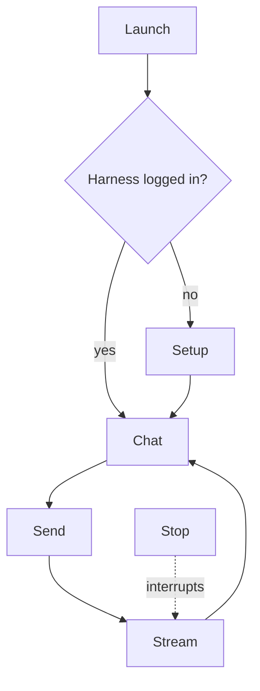
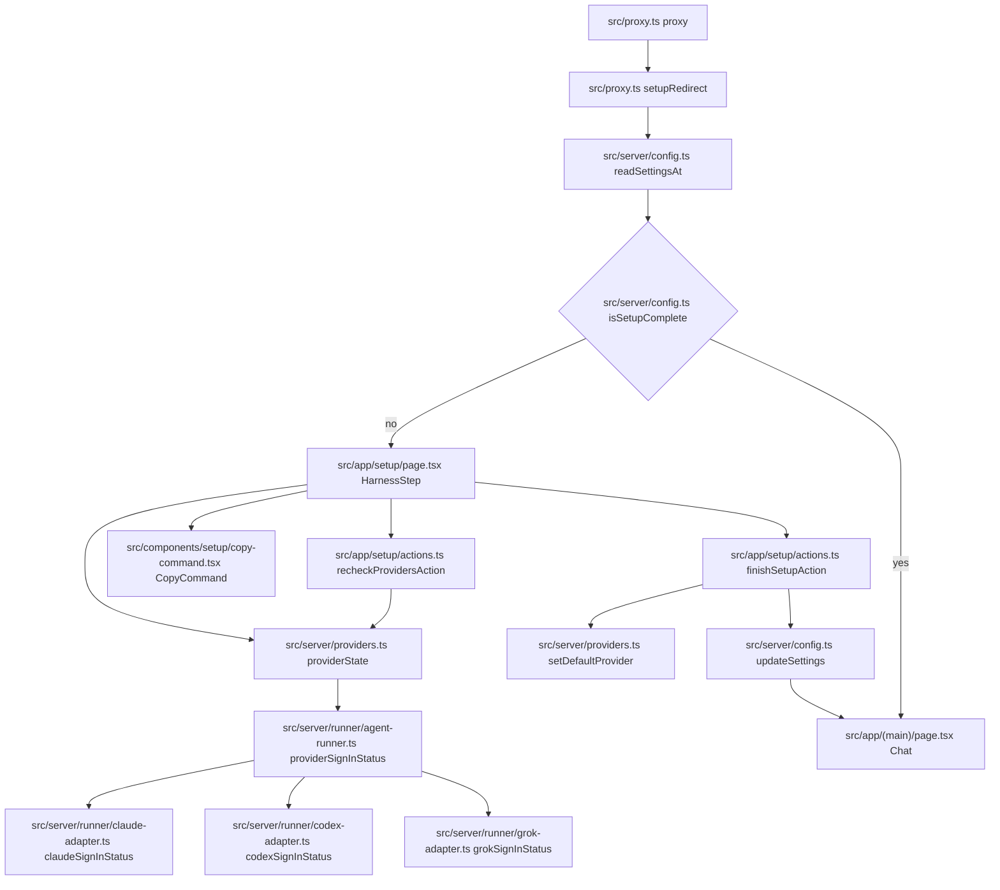
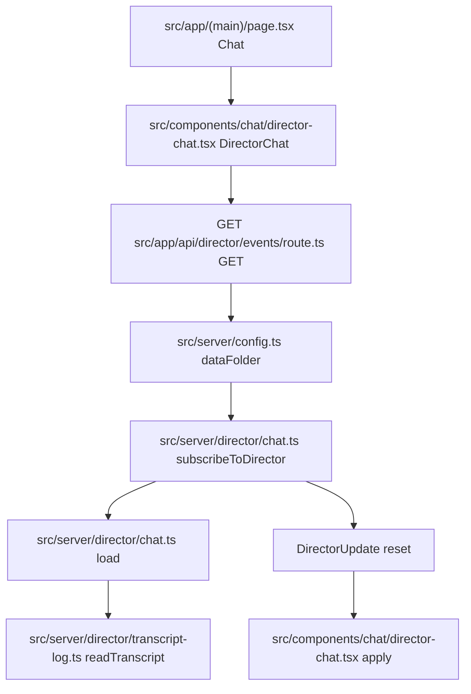
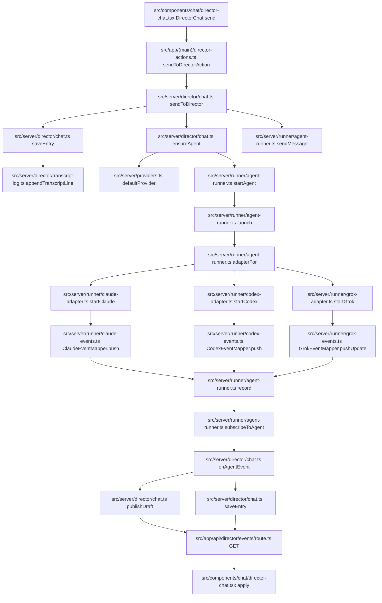
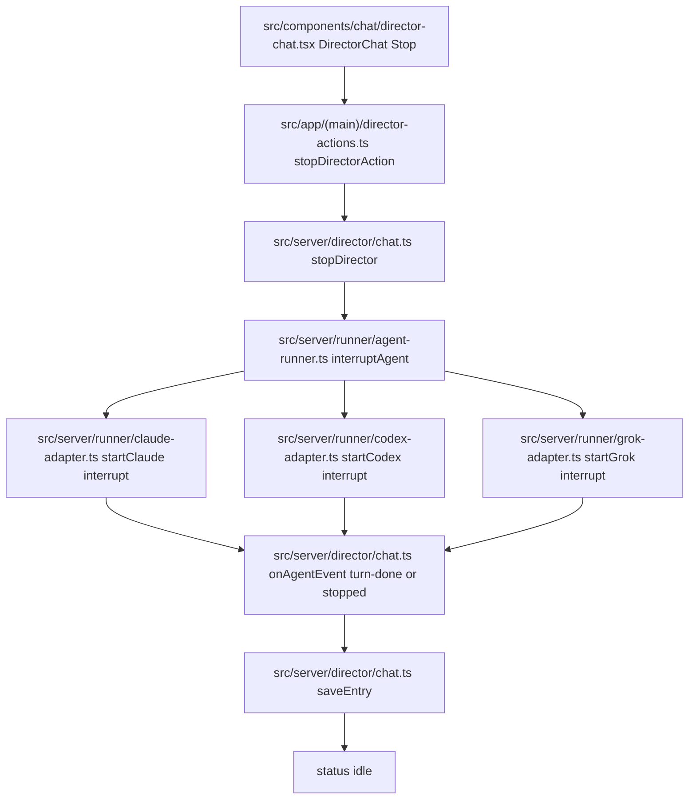

# Domain map

BusyBoy is harness login, then one Director chat. The signed-in CLI (Claude Code, Codex, or Grok) writes the reply. BusyBoy stores the transcript and streams that text. Stop interrupts the running turn.

Read this file before tracing a flow through the code. Update it in the same pull request when a flow or a code path named here changes.

## Information architecture

Launch is `src/proxy.ts` `proxy`. "Harness logged in?" is `src/server/config.ts` `isSetupComplete`: `setupCompletedAt` is set only after Continue on a signed-in harness.

## Setup

The only setup step is signing in to a harness the person already has. BusyBoy does not sign in for them.

Code paths:

- `src/proxy.ts` `proxy`, `isAllowedHost`, `setupRedirect`
- `src/server/config.ts` `resolveDataFolder`, `readSettingsAt`, `readSettings`, `isSetupComplete`, `updateSettings`
- `src/app/setup/page.tsx` `HarnessStep`, `BackToChat`
- `src/server/providers.ts` `providerState`, `signedInProviders`, `defaultProvider`, `setDefaultProvider`
- `src/server/runner/agent-runner.ts` `providerSignInStatus`, `adapterFor`
- `src/server/runner/claude-adapter.ts` `claudeSignInStatus`, `resolveClaude`
- `src/server/runner/codex-adapter.ts` `codexSignInStatus`, `accountStatus`, `resolveCodex`
- `src/server/runner/grok-adapter.ts` `grokSignInStatus`, `resolveGrok`
- `src/server/runner/find-executable.ts` `findExecutable`
- `src/components/setup/copy-command.tsx` `CopyCommand`
- `src/app/setup/actions.ts` `recheckProvidersAction`, `finishSetupAction`

## Chat

After setup, one screen holds the transcript and the composer.

Code paths:

- `src/app/(main)/layout.tsx`
- `src/app/(main)/page.tsx` `Chat`
- `src/components/chat/director-chat.tsx` `DirectorChat`, `apply`, `MessageView`
- `src/hooks/use-external-sync.ts` `useExternalSync`
- `src/app/api/director/events/route.ts` `GET`
- `src/server/config.ts` `dataFolder`
- `src/server/director/chat.ts` `subscribeToDirector`, `getDirector`, `load`
- `src/server/director/transcript-log.ts` `readTranscript`

## Send and Stream

Send stores the person's text, starts or resumes the signed-in harness in the home directory, and hands it the message. Stream is the harness text as it arrives. The turn then returns to Chat.

`startClaude` turns text into a Claude user message with `src/server/runner/user-turn.ts` `claudeContent` and `modelText`. `startCodex` uses `codexInput` and `modelText`. `startGrok` uses `modelText`. `src/server/runner/find-executable.ts` `findExecutable` and `agentEnvironment` locate the CLI and build its environment. `src/server/director/context.ts` `DIRECTOR_INSTRUCTIONS` is the system prompt passed to `startAgent`.

Permission calls the harness still sends to the host are accepted inside the adapter (`startClaude` `canUseTool`, `startCodex` approval replies, `startGrok` `decide`) so BusyBoy does not show an approval card. The launch mode is the harness auto mode: `startClaude` uses `auto`, `src/server/runner/codex-adapter.ts` `codexThreadSettings` uses `auto_review`, and `src/server/runner/grok-adapter.ts` `grokPermissionMode` uses `auto`.

Code paths:

- `src/components/chat/director-chat.tsx` `DirectorChat`
- `src/app/(main)/director-actions.ts` `sendToDirectorAction`
- `src/server/director/chat.ts` `sendToDirector`, `ensureAgent`, `onAgentEvent`, `saveEntry`, `publishDraft`, `saveState`
- `src/server/director/transcript-log.ts` `appendTranscriptLine`
- `src/server/director/context.ts` `DIRECTOR_INSTRUCTIONS`
- `src/server/providers.ts` `defaultProvider`
- `src/server/runner/agent-runner.ts` `startAgent`, `launch`, `adapterFor`, `sendMessage`, `subscribeToAgent`, `record`
- `src/server/runner/user-turn.ts` `asTurn`, `modelText`, `claudeContent`, `codexInput`
- `src/server/runner/claude-adapter.ts` `startClaude`
- `src/server/runner/claude-events.ts` `ClaudeEventMapper`
- `src/server/runner/claude-process.ts` `spawnClaudeProcess`
- `src/server/runner/codex-adapter.ts` `startCodex`, `codexThreadSettings`
- `src/server/runner/codex-events.ts` `CodexEventMapper`
- `src/server/runner/grok-adapter.ts` `startGrok`, `grokPermissionMode`
- `src/server/runner/grok-events.ts` `GrokEventMapper`
- `src/server/runner/find-executable.ts` `findExecutable`, `agentEnvironment`
- `src/app/api/director/events/route.ts` `GET`

## Stop

Stop interrupts the harness turn. The partial reply, if any, is stored and the chat returns to idle.

Code paths:

- `src/components/chat/director-chat.tsx` `DirectorChat`
- `src/app/(main)/director-actions.ts` `stopDirectorAction`
- `src/server/director/chat.ts` `stopDirector`, `onAgentEvent`, `saveEntry`, `setStatus`
- `src/server/runner/agent-runner.ts` `interruptAgent`
- `src/server/runner/claude-adapter.ts` `startClaude`
- `src/server/runner/codex-adapter.ts` `startCodex`
- `src/server/runner/grok-adapter.ts` `startGrok`
