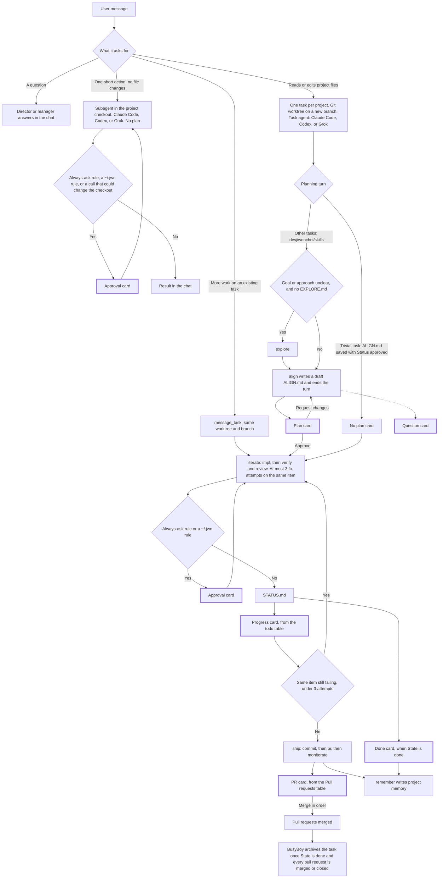
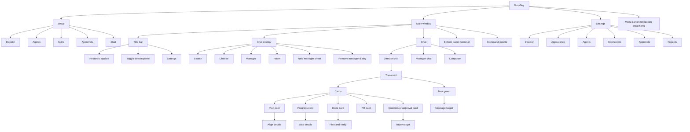

<!-- do not edit this file -->

Vision:

1. Aligned "end state" is the alpha and omega. Once aligned with it you should receive the end state what you expected otherwise it's a failure. Models don't care about your intention or goal. It's ambiguous by nature. However the end state can be more physically fixed which makes deriving success criteria and verification steps easier.
2. DDD: diagram-driven development, show e2e workflow from beginning to end state as a diagram. Who reads code when they need to read tons of model responses? No, who even reads those text anymore? Your understanding is the bottleneck and visualization is the key. And at the end of the day programming is just a big set of functions represented by booleans. If-else, yes no, 0 or 1. And diagram is good at representing those tree of nodes.
3. https://github.com/devjiwonchoi/skills should be the core brain of the workflow, and BusyBoy being a wrapper around it to manage multiple projects. Skills should be harness agnostic.
4. Why need BusyBoy? I want to find the best interface that works for me to work on multiple projects without being stressed out by context switching and approving/steering tons of shit that I would eventually forget what the heck this session was about. I want to stop juggling all these stuff but instead get aligned once, and receive the result I expected. No more TODOs. BusyBoy should make your TODOs into an actual result.

## E2E workflow

A user message starts in the Director chat, or in one project's manager chat. The Director and managers do not edit files or run the work themselves. Nodes drawn with a thick border are cards in that chat.

A task is trivial only when there is one obvious place and way to make the change, no design choice, and the change is easy to revert. The agent then saves `ALIGN.md` with `Status: approved` and keeps working in that same turn, so no plan card opens. Any doubt makes it the other path: `explore` when the goal or approach is unclear, then `align` writes a draft `ALIGN.md` and ends the turn, which opens the plan card. `STATUS.md` is read again at the end of each turn. The todo table is the progress card, `State: done` replaces it with the done card, and the Pull requests table is the PR card. Merge in order merges those pull requests from the card. BusyBoy does not merge them on its own. Once the turn is finished, the plan is not a draft, and `State` is done, BusyBoy archives the task. When that `STATUS.md` lists pull requests, it waits until each one is merged or closed.

## Information architecture

The app is three routes. `/` is the chat. `/setup` is the first run, and `/` and `/settings` redirect there until setup is finished. `/settings` is the later settings page.

**Setup.** Five steps, with Back and Continue. Director: pick Jota, Rippu, Ming, Yam, or Jjeromming, and optionally a picture of your own. Agents: see whether Claude Code, Codex, and Grok are signed in, copy a login or update command, check again, and pick the default when more than one is signed in. Skills: see whether the `jwn` plugin from `devjiwonchoi/skills` is installed, copy its install command, or skip. Approvals: edit the always-ask list, one rule per line, restore the defaults, or skip. Start: add git folders by path, or in the desktop app by choosing or dropping folders, remove one, then start chatting. You can start with no project.

**Title bar.** The bottom-panel toggle, Settings, and, in the desktop app after an update has downloaded, Restart to update. Working tasks carry on after that restart.

**Chat sidebar.** Shown from the medium breakpoint up. Search filters managers and rooms. The Director row opens the Director chat and shows a status line plus how many aligned items are verified. A manager row opens that manager's chat, shows the same kind of progress for its project, and can be removed. Removing a manager stops it and moves its tasks into the Director chat. The project stays. A room is a row for two or more projects. It does not open a chat. New manager asks for a name, then an existing project, a room of several projects, or another git folder.

**Director chat.** The companion greets you. You send a message, queue more while a reply is running, edit and resend your last message, retry a failed turn, copy a message, and stop the reply. `@` names a project. `/` offers installed skills plus new task, stop, and archive. You can attach files and dictate. Task lines, cards, and closed cards stay in the transcript.

**Manager chat.** The same chat, for one project. The header names that manager and project. `@` offers files in the project. A request here becomes a task in that project only.

**Task group.** Each task the chat started is one line: project, title, and phase. Press the line to point the terminal at its worktree, and press it again to clear that. Message points the composer at that task for one message. Stop ends its agent. Archive puts it away when it is not working, and Restore brings it back. A subagent is badged, shows its one-line result, and cannot be selected or messaged again.

**Plan card.** Summary, end-state list, and Aligning. View details opens the draft `ALIGN.md`, including its diagram. Approve sends "Approved." Request changes sends what you type.

**Progress card.** Todo steps from `STATUS.md`, with the phase. View details spells each step out. There is no other action.

**Done card.** One line: the task name, Done, or PR while a pull request is still open, plus how many agreed end-state items were met on the default branch when that count exists. View plan opens `ALIGN.md` and, when it exists, `VERIFY.md`.

**PR card.** One row per pull request in stack order, with its check or review text. Open follows the first URL. Merge in order merges them from the bottom of the stack. Nothing merges until that click.

**Question or approval card.** Lettered options. One single-choice question is answered by the click. Otherwise you pick, then Answer. Reply sends your own text. Stop task ends the task. An approval from a Director connector does not stop a task. A closed card stays in the transcript with its outcome.

**Composer.** Sends to the Director, the manager, a chosen task, or the card you are replying to. The chip says which, and you can point it back. Archive from `/` puts away the task you are messaging.

**Terminal.** A shell in the selected task's worktree, or in your home folder when none is selected. Changing the selection does not move a shell that is already running. New terminal starts one in the current selection. Close kills it. In the desktop app, Open in editor and Reveal in folder use that shell's folder.

**Command palette.** Search chats, task titles, and commands. New task opens the new-manager sheet. Settings opens settings. A hit switches to that chat.

**Settings.** Director: change the companion and picture. Appearance: System, Dark, or Light. Agents: the harness every chat uses, sign-in state, the skills plugin, login and install commands, and Check again. Connectors: Claude Code and Codex MCP servers, their status, a login command when one is needed, and Add for Slack, Linear, and Notion. Approvals: edit or restore the always-ask list. Projects: the git folders, remove one without deleting its folder, and add another.

**Menu bar or notification area.** In the desktop app: open BusyBoy, open a task that needs you, or open the Director after a reply you have not seen. Restart to update when a version is downloaded. Quit. On macOS the dock badge counts what needs you while the window is in the background.
