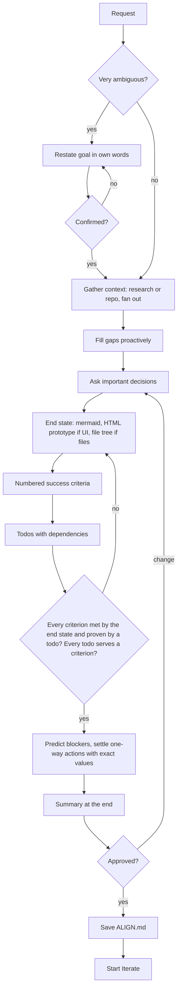
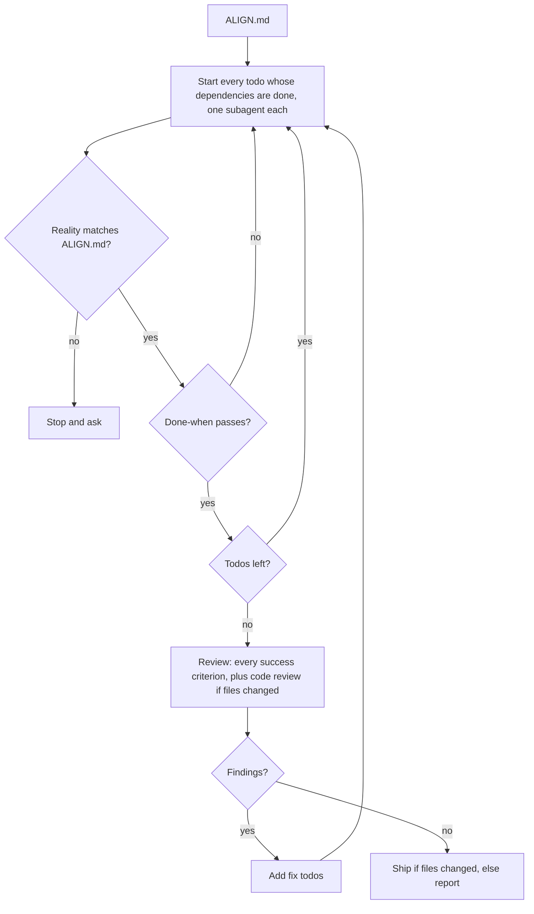

# ALIGN: Replace plan with align

Status: approved by the user on 2026-11-03.

# 1 · Goal

- **Align** turns any request (research, brainstorm, build, fix, debug, computer-use tasks) into an approved `ALIGN.md`. It proves the end state meets every success criterion and settles every human decision up front, including one-way actions with exact values. It does no execution. On approval it starts Iterate.
- **Iterate** runs an aligned plan: execute, review, repeat. Every todo whose dependencies are done goes to its own subagent.

## User's original request (source of truth for align's steps)

1. User provides the goal or a task to do (research, brainstorm, build software, fix bug, debug, etc.).
2. Align's goal is to draw the end state of the request and fill the gaps to achieve it.
3. If the request is very ambiguous, restate the goal in your own words and get confirmation before proceeding.
4. Gather context around the topic (research, or look into the brownfield app) and fill gaps proactively.
5. Ask questions to settle the important decisions or clarify.
6. Set up the end state, how it looks when the goal is achieved:
   - Mermaid walkthrough of the full workflow (NO pseudo code — user removed it)
   - If it involves UI, quickly build a throwaway HTML prototype
   - If editing files, show the full file tree with a comment on why each file is created/modified/deleted
7. Write down all success criteria that mean the goal is achieved.
8. Break down all todo tasks needed to achieve the goal. Fan out whatever can be fanned out.
9. Get approval or iterate until the user is satisfied and fully aligned.

The plan must give very specific, step-by-step instructions per task: what to achieve and how. After approval, tasks go to subagents; no forced compaction or fresh-context handoff.

# 2 · Decisions (all user-confirmed)

1. Scope: replace `plan` with `align` and rework iterate. Other skills only get reference rewiring; they get redesigned later.
2. Handoff: approval starts Iterate automatically.
3. Iterate runs any aligned plan (code or not). Review (code review) and Ship run only when files changed.
4. One-way actions (buy/pay, send a message, delete data, publish, merge, deploy) are settled in align with exact values (item, total, recipient, text, target). Align does reversible prep during context gathering to learn the real values (e.g. add to cart and read the checkout total). Approving the plan is the final confirm. Two-way actions (file edits, commit, push branch, open PR, drafts, add to cart) run on approval.
5. Align predicts where the run could need a human (sign-in/2FA, CAPTCHA, missing access or permission grants, missing info, payment or credential entry, external waits, one-way actions) and clears them before approval. Every checkpoint ends cleared or approved with exact values.
6. Iterate's only stop rule: reality differs from `ALIGN.md` (including an unplanned blocker), or a loop makes no progress.
7. Scheduling is by each todo's `Depends on`, with no groups or barriers. Iterate starts every todo whose dependencies are done. `1a`/`2a` numbering is only a reading aid. Todos that could share a file or stateful resource (screen, browser session, account) get a dependency so they never run at once.
8. Coverage check in align, both directions: every criterion is met by the end state, built by a todo, and proven by a done-when check; every todo serves at least one criterion (otherwise cut it). Gaps send align back to revise.
9. Plan presentation format:
   - Sections are `#` headings in this order: Goal, Decisions, End state, Success criteria, Human checkpoints, Todos, Summary. Sections separated by `---`.
   - Each success criterion and each todo is a `##` heading numbered `1 ·` (not `1.`). End state sub-views (each flow diagram, prototype, file tree) are also `##`. No `###`. Everything else is normal text.
   - Criteria start with an action verb and name what meets them and what proves them.
   - End state uses Mermaid only (no pseudo code). Quote Mermaid labels that contain punctuation and check each diagram parses before presenting.
   - The plan ends with a short Summary for a quick decision: what, size, key choices, when the user is needed, what approval authorizes.
10. README: change only the flow line to `align -> iterate -> ship -> retro`.
11. Delivery: one commit, one ready-for-review PR `Replace plan with align`, moniterate. No merge.

# 3 · End state

## 1 · Align flow



## 2 · Iterate flow



## 3 · Todo spec (goes in the template)

```markdown
## 2a · <title> (subagent)

- Door: two-way | one-way · approved: <exact values>
- Depends on: 1a
- Serves: criteria 3, 5
- Goal: what is true when it's done
- Files: exact paths to create, modify, or delete
- How: numbered concrete steps
- Done when: observable checks
```

## 4 · File tree

```text
skills/
  align/                              # NEW, replaces skills/plan
    SKILL.md                          # planning steps incl. coverage check, ends in handoff
    references/template.md            # ALIGN.md sections, todo spec, coverage, summary
  plan/                               # DELETED (whole directory)
  iterate/iterate/SKILL.md            # MODIFIED: execute by dependency, review, repeat
  iterate/iterate/references/recording.md  # MODIFIED: ALIGN.md; per-todo results, deviations
  iterate/quick-impl/SKILL.md         # MODIFIED: works from one todo spec
  ship/ship/SKILL.md                  # MODIFIED: "approved plan" → ALIGN.md
  utils/references/recording.md       # MODIFIED: ALIGN.md row owned by Align
hooks/hooks.json                      # MODIFIED: compact reminder reads ALIGN.md
.claude-plugin/plugin.json            # MODIFIED: ./skills/plan → ./skills/align
.codex-plugin/plugin.json             # MODIFIED: same
README.md                             # MODIFIED: flow line only
```

Removed concepts (must not survive anywhere): 14-area decision ledger and its statuses, Advocate/Critic/Skeptic debate, effort levels (`--effort`), plan review reference, pseudo code, handoff to a fresh execution context / compaction, baseline test preparation inside planning, persistent-goal setting.

# 4 · Success criteria

## 1 · Delete `skills/plan/` and add `skills/align/SKILL.md`

- It has `name: align` and a `Use when …` description.
- Met by: 1a. Proven in 2: `ls` and a frontmatter check.

## 2 · Cover the user's 9 points in order in align's steps

- Plus the coverage check, blocker prediction, and one-way settlement.
- Ends at an approved `ALIGN.md` and starts Iterate. No execution steps.
- Met by: 1a. Proven in 2: the walkthrough.

## 3 · Remove the ledger, debate, effort levels, pseudo code, and fresh-context handoff

- Met by: 1a and 1b. Proven in 2: grep.

## 4 · Require the plan format in the template

- Decision 9 in full, the todo spec, the dependency rule for shared files/resources, the coverage check, and the closing summary.
- Met by: 1a. Proven in 2: review.

## 5 · Make Iterate only execute, review, and repeat

- Starts every todo whose dependencies are done; re-runs a todo until its done-when passes.
- Reviews every criterion, adding code review (Review skill) when files changed; turns findings into fix todos.
- Ships (if files changed) or reports at the end.
- Stops only on a deviation from `ALIGN.md` or no progress.
- Met by: 1b. Proven in 2: the walkthrough.

## 6 · Leave zero hits for `skills/plan`, `PLAN.md`, or Plan-skill links

- Met by: 1a, 1b, 1c. Proven in 2: repo-wide grep.

## 7 · Resolve every relative link under `skills/`

- Met by: 1a, 1b, 1c. Proven in 2: link-check script.

## 8 · Keep both manifests and `hooks.json` valid JSON

- Pointing at `align` / `ALIGN.md`.
- Met by: 1c. Proven in 2: `jq`.

## 9 · Pass the three-case walkthrough

- A reviewer subagent walks align → iterate on a bug fix, a research question, and a computer-use purchase. No step stuck or skipped.
- Met and proven by: 2.

## 10 · Open one commit and one ready-for-review PR without merging

- Title `Replace plan with align`.
- Met by: 3. Proven by: the PR URL.

# 5 · Human checkpoints

1. GitHub access: cleared (`gh` signed in as devjiwonchoi, `repo` scope).
2. CI: cleared (no CI workflows in repo).
3. Subagent permissions: cleared (auto mode).
4. Merge: out of scope, one-way, user does it. Then run sync-skills.

# 6 · Todos

## 1a · Write the align skill (subagent)

- Door: two-way. Depends on: none. Serves: 1–4, 6, 7.
- Files: create `skills/align/SKILL.md`, `skills/align/references/template.md`. Delete `skills/plan/`.
- How: turn the align flow into numbered steps ending at the handoff; put format, todo spec, coverage check, summary in the template; `git rm -r skills/plan`; trim with write-skill and delete.
- Done when: criteria 1–4 hold for these files.

## 1b · Rework iterate into execute → review → repeat (subagent)

- Door: two-way. Depends on: none. Serves: 3, 5, 6, 7.
- Files: `skills/iterate/iterate/SKILL.md`, `skills/iterate/iterate/references/recording.md`.
- How: description `Use when executing an aligned plan.`; three steps (execute by dependency via subagents, review, repeat with fix todos); stop rule; record each todo's result and any deviation in `STATUS.md`.
- Done when: criterion 5 holds and grep is clean for these files.

## 1c · Rewire the remaining references (subagent)

- Door: two-way. Depends on: none. Serves: 6–8.
- Files: `skills/iterate/quick-impl/SKILL.md`, `skills/ship/ship/SKILL.md`, `skills/utils/references/recording.md`, `.claude-plugin/plugin.json`, `.codex-plugin/plugin.json`, `hooks/hooks.json`, `README.md`.
- How: swap Plan/`PLAN.md` for Align/`ALIGN.md`; point quick-impl at a single todo spec.
- Done when: grep and `jq` pass for these files.

## 2 · Verify (main agent)

- Door: two-way. Depends on: 1a, 1b, 1c. Serves: 1–9.

## 3 · Ship (main agent)

- Door: two-way, approved. Depends on: 2. Serves: 10.
- Commit on `claude/repo-architecture-align-plan-b4e3a5`, push, open PR, moniterate.
